# Classifying Apples, Potatoes and Cucumbers from Electrical Responses with an ESP32-S3

Experimental project • 20–21 October 2026

I investigated whether an ESP32-S3, two metal electrodes and a 10 kΩ resistor could distinguish apples, potatoes and cucumbers from their electrical responses. I started with single-electrode capacitive sensing, then switched to two-electrode pulse measurements. Classification runs on the microcontroller; the onboard RGB LED displays the result.

The starting point was projects such as the [Makey Makey banana piano](https://makeymakey.com/blogs/how-to-instructions/first-time-set-up-basic-how-to-guide), where produce becomes part of an electrical interface. Here, the objective is to identify the connected produce from measurements.

In the final series, the prototype returned 30 correct predictions across 15 specimens: five apples, five potatoes and five cucumbers, with two electrode placements per specimen. Each measurement took 7.6 seconds. This article describes the hardware, measurements, algorithm and recorded results.

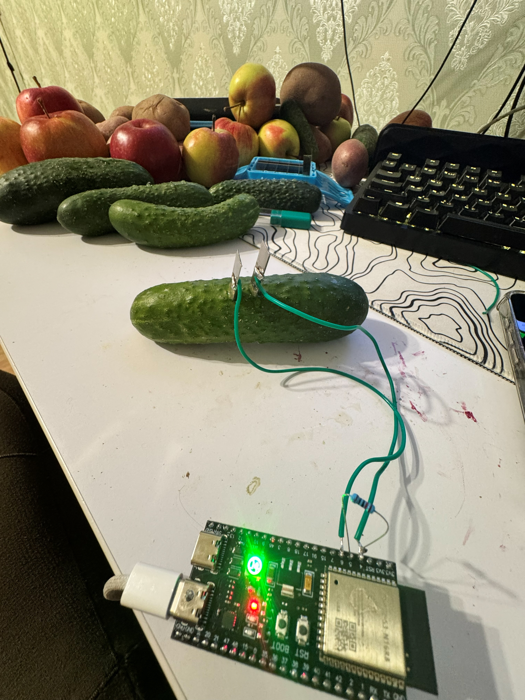

*ESP32-S3, a series resistor and two electrodes inserted into a cucumber. The green LED indicates “cucumber.” This photograph documents the assembly, not an inventory of every test specimen.*

## 1. Single-electrode capacitive sensing

I initially connected one electrode to GPIO4, configured as a capacitive touch input. Touching a potato changed the sensor reading and controlled the LED.

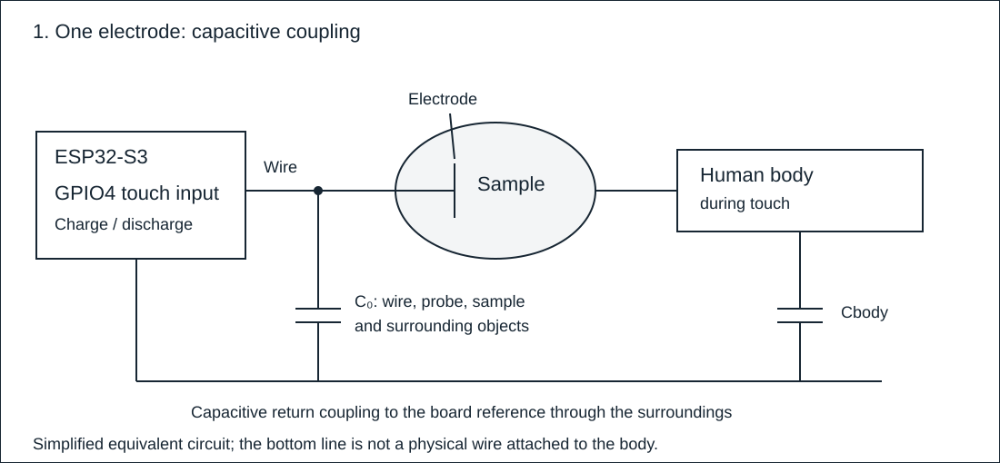

*Figure 1. A simplified equivalent circuit during touch.*

| Diagram label | Meaning |
|---|---|
| ESP32-S3, GPIO4 | The microcontroller and its programmable pin 4, used here as a capacitive sensor |
| Electrode and wire | The metal contact with the specimen and its connection to the board |
| C₀ | Combined capacitance of the wire, electrode and specimen relative to the surroundings and board reference |
| Cbody | Equivalent capacitive coupling of the body to the board reference through the surroundings |
| Two parallel lines | The circuit symbol for capacitance: the ability to store electrical charge |
| Lines and dots | Equivalent connections and junctions. The bottom line does not represent a separate wire attached to the person |

The capacitances are conceptual components of the model. For proximity without contact, the hand-to-specimen coupling is also capacitive; the drawing shows touch.

Capacitance C describes the charge Q stored at a voltage U: C = Q/U. Charge is measured in coulombs (C), voltage in volts (V), and capacitance in farads (F); 1 picofarad (pF) = 10⁻¹² F. The ESP32-S3 touch peripheral repeatedly charges and discharges its input, producing a count that depends on the capacitive load. Touch changes the coupling and therefore the count.

The touchRead function returns a sensor count in arbitrary units. A reading of 25,953 is not 25,953 pF, millivolts or ohms. No conversion to physical capacitance was used. Counts are compared under the same configuration, while accounting for the wire, contact and surroundings. Technical reference: [Espressif touch sensor documentation](https://docs.espressif.com/projects/esp-idf/en/latest/esp32s3/api-reference/peripherals/cap_touch_sens.html).

The exploratory recordings overlapped: a 100 g apple averaged approximately 25,953, a 50 g cucumber 25,969, and a 105 g potato 25,987. Conditions changed during this stage, and the cucumber recording had appreciable variation. This was evidence of overlap in this pilot, not proof that capacitive classification is impossible.

## 2. Wire and electrode controls

I tested the measurement chain in stages: the disconnected input, the wire without the metal tooth, and then the attached electrode. After measuring a specimen, I compared readings before and after cleaning and separately changed the wire position. Each state has two recorded blocks of 150 counts.

| State | Block 1 mean | Block 2 mean |
|---|---:|---:|
| Input without wire | 15,929 | 15,925 |
| Wire only | 20,718 | 20,713 |
| Wire and electrode in air | 21,520 | 21,476 |
| After removal from specimen | 25,750 | 25,700 |
| After cleaning and drying | 22,016 | 22,028 |
| Wire moved | 21,751 | 21,752 |
| Wire returned | 21,990 | 21,990 |

*Values are touchRead counts. These are sequential states of one assembly, not independent repetitions across instruments. Source records are in data/pilot.*

A substantial part of the signal was present before insertion into a specimen. Removal and cleaning also changed the baseline, although these observations do not isolate juice as the cause. Moving the wire changed the mean by approximately 1.2% in this check; it would be incorrect to attribute every difference to wire movement.

I changed the measurement method: establish a current path between two contacts and record how the response changes over time.

## 3. Two-electrode pulse measurements

I added a second matching electrode and a 10 kΩ resistor. The board applies a pulse and samples the voltage at 1, 5 and 20 ms, then reverses the excitation and repeats the three readings. One placement produces six features.

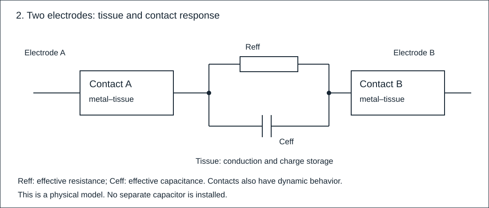

*Figure 2. A simplified electrical model of the sample. This is a model of physical properties, not a wiring diagram: no separate capacitor is installed. Figure 3 shows the actual circuit with its 10 kΩ resistor.*

| Diagram label | Meaning |
|---|---|
| Electrodes A and B | The two metal contacts used to excite the sample |
| Contact A / Contact B | Metal–tissue interfaces, which affect conduction, charge storage and response shape |
| Reff, rectangle | Effective tissue resistance, measured in ohms (Ω) |
| Ceff, two parallel lines | Effective tissue capacitance, measured in farads (F) |
| Two branches between common nodes | Parallel resistance and capacitance, both exposed to the same voltage |

“eff” means effective: the elements represent combined sample properties, not individual cells. This is an explanatory model rather than a fitted RC circuit.

Plant tissue fluid contains ions, or electrically charged particles. Their motion under an applied voltage produces current. Cell membranes separate conductive regions, and metal–tissue interfaces redistribute charge. Voltage can therefore change after a pulse begins: this is the transient response. It includes tissue properties, electrode geometry and contact conditions.

For a resistive element, Ohm’s law relates voltage U, current I and resistance R: U = IR. Current is charge passing per unit time; its unit is the ampere (A), and 1 microampere (µA) = 10⁻⁶ A. A simple RC circuit has a characteristic time τ = RC, measured in seconds. Tissue and two interfaces are more complex. Here the measured voltages are features, rather than separate estimates of R, C or τ. See the [review of electrical models of plant tissue](https://pmc.ncbi.nlm.nih.gov/articles/PMC10426379/) for the physical background.

## 4. Wiring and electrode geometry

The assembly uses an ESP32-S3 N16R8, a 10 kΩ resistor, two matching metal teeth from a kitchen potato cutter, and wires. On this board, the onboard RGB LED is connected to GPIO48 and BOOT to GPIO0.

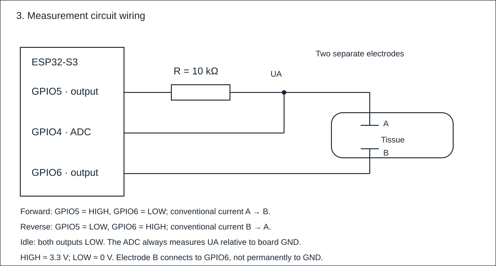

*Figure 3. The two-electrode measurement circuit. USB power is omitted.*

| Diagram label | Meaning |
|---|---|
| GPIO5 · output | Drives the sample through the series resistor |
| R = 10 kΩ | A physical 10,000 Ω resistor. Limits current and produces a voltage drop dependent on the sample response |
| A and B | Electrodes in the tissue. A connects to the resistor and GPIO4; B connects to GPIO6 |
| GPIO4 · ADC | Measurement input. The analog-to-digital converter translates voltage into a numeric code |
| UA | Voltage at node A relative to GND, recorded in millivolts; 1,000 mV = 1 V |
| GPIO6 · output | Switches the potential of electrode B |
| GND | Board reference potential. Electrode B is not permanently grounded |
| HIGH / LOW | Output levels of approximately 3.3 V / 0 V relative to GND |
| A → B / B → A | Conventional positive current direction during forward / reverse excitation |
| Lines and filled dot | Wires and an electrical junction |

GPIO means a general-purpose input/output pin. GPIO5 and GPIO6 excite the circuit; GPIO4 measures voltage.

Figures 2 and 3 describe the same A-to-B sample at different levels. The tissue section in the wiring diagram is represented by contact A, the Reff/Ceff model, and contact B in the physical model. The external 10 kΩ resistor is a real component. Reff and Ceff describe the specimen and are not extra parts to install.

During forward excitation, GPIO5 is HIGH and GPIO6 LOW. Reverse excitation swaps them. The ADC stays at electrode A in both cases. Reverse readings are still positive voltages relative to GND, not negative current or the voltage directly across the two electrodes.

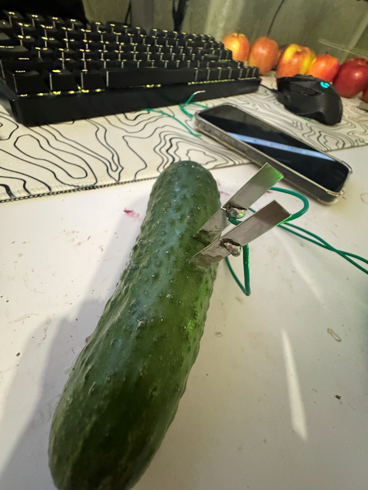

*The immersed section of each electrode is 7.5 mm wide and 13 mm long. These are element dimensions, not a claim of identical depth in every measurement. Wire connections remain above the surface.*

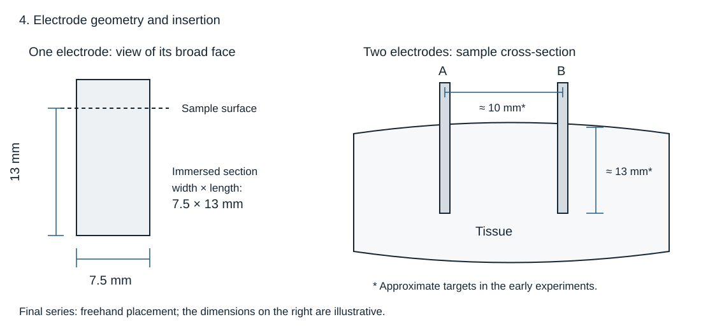

*Figure 4. Left: dimensions of one electrode’s immersed section. Right: insertion of two electrodes into tissue. The drawing is not to scale; plate orientation and thickness are schematic.*

| Drawing label | Meaning |
|---|---|
| 7.5 mm | Width of the immersed tooth section; 1 mm = 0.001 m |
| 13 mm, left | Length of that section, not the measured insertion depth of every trial |
| A and B | The same electrodes as in Figures 2 and 3: A connects to GPIO4 and the resistor; B to GPIO6 |
| ≈ 13 mm, right | Approximate insertion depth targeted in the early experiments |
| ≈ 10 mm | Approximate spacing targeted in early experiments. The distance reference was not precisely documented |
| Sample outline and “Tissue” | Electrodes enter the tissue from outside, with wire connections above the surface |

For the final series I inserted the probes by eye, without a mechanical stop. I then removed my hands and kept the specimen and wires still. Geometry was freehand rather than measured for each placement.

## 5. Sampling sequence and features

| Quantity | Unit | Meaning |
|---|---|---|
| t | ms | Time since the pulse started; 1,000 ms = 1 s |
| Raw ADC count | Integer 0–4095 | One of 4,096 possible codes at the selected 12-bit resolution |

Before each pulse, both outputs remain LOW for 30 ms. The board begins reading approximately 1, 5 and 20 ms after switching, then returns both outputs to LOW. One pair contains forward and reverse pulses. A 400 ms pause separates pairs. Fast mode waits 5 seconds initially and records six pairs.

Feature names use F for forward, R for reverse, and the sampling delay in milliseconds. R in R1 is not resistance. The feature vector is [F1, F5, F20, R1, R5, R20]. Each feature is the mean of six corresponding voltage readings, one per pulse pair. Averaging reduces random fluctuations; six cycles are not six independent specimens.

| Feature | Sampling point | FINAL01, placement 1, mV |
|---|---|---:|
| F1 | Forward, 1 ms | 451.333 |
| F5 | Forward, 5 ms | 483.333 |
| F20 | Forward, 20 ms | 540.833 |
| R1 | Reverse, 1 ms | 2918.333 |
| R5 | Reverse, 5 ms | 2881.000 |
| R20 | Reverse, 20 ms | 2813.167 |

These are actual readings from one potato: UA increased during the forward pulse and decreased during the reverse pulse. A value of 451.333 mV represents about 0.451 V at node A. Three decimal places result from averaging; they do not imply 0.001 mV instrument accuracy.

In the firmware, analogRead returns a raw ADC code and analogReadMilliVolts returns a calibrated conversion to millivolts. These are sequential reads, so the specified delays describe the start of reading rather than the exact times of both samples. ADC_11db input attenuation extends the ADC input range. Dividing 3.3 V by 4095 is not an adequate calibration here. Reference: [Arduino-ESP32 ADC documentation](https://docs.espressif.com/projects/arduino-esp32/en/latest/api/adc.html).

For an idealized illustration of the resistor’s role, if the forward output is 3.3 V and UA is 0.451 V, current through 10 kΩ is approximately (3.3 − 0.451) / 10,000 = 0.000285 A, or 285 µA. This is a calculation with idealized GPIO levels, not an independent current measurement. Electrode-to-electrode voltage is UA − UGPIO6, whose sign changes during reverse excitation. The model uses UA without that conversion.

This circuit records transient voltages, not an impedance spectrum versus frequency, and does not separate tissue from contact effects. Open-circuit and touching-probe checks were performed.

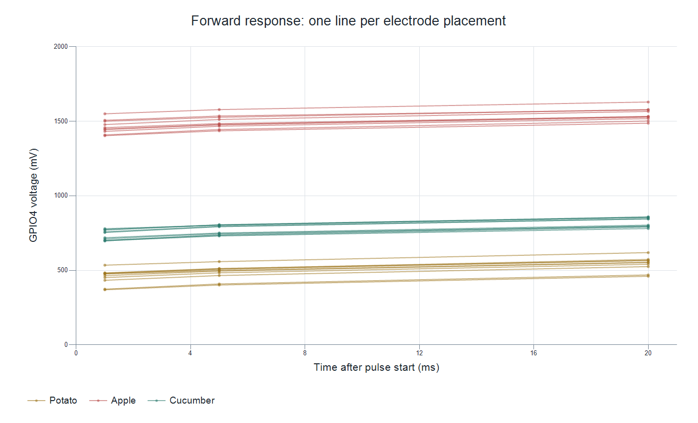

*Thirty lines represent the final 30 placements. Each point averages six cycles of one placement. Connecting lines are visual guides; a continuous waveform was not recorded between samples.*

## 6. Algorithm and classifier training

I used a nearest-centroid classifier. Training calculates statistics from six labeled specimens. The resulting coefficients are fixed in firmware and do not change during recognition.

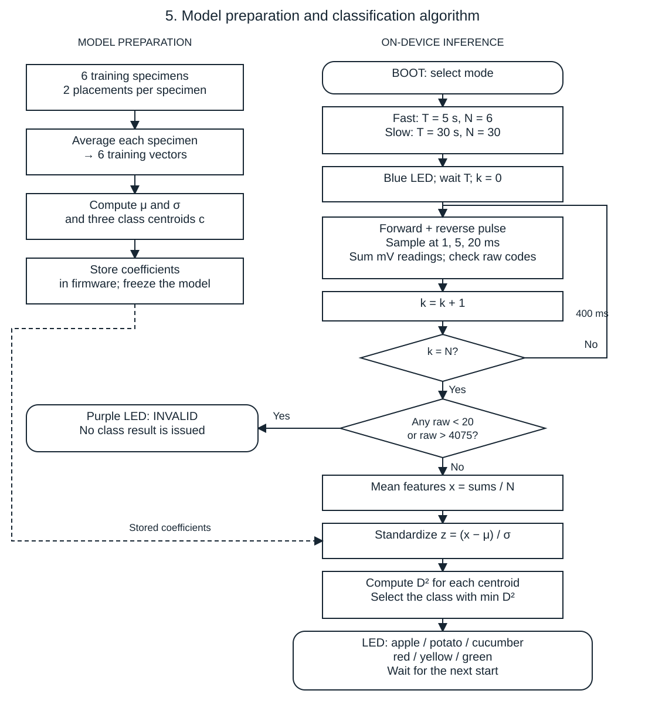

*Figure 5. Left: model preparation before testing. Right: one measurement on the ESP32. The dashed line transfers stored coefficients; it does not represent online learning.*

| Flowchart notation | Meaning |
|---|---|
| Rounded box / rectangle / diamond | Start or end / operation / condition |
| N, k | Target number of pulse pairs and number already recorded |
| T | Initial waiting time: 5 s in fast mode or 30 s in slow mode |
| raw | Raw ADC code. Any value below 20 or above 4075 invalidates the measurement |
| x | Six mean voltages in mV: F1, F5, F20, R1, R5, R20 |
| μ, σ | Training mean and standard deviation for each feature |
| z, c | Standardized measurement and class centroid; both dimensionless |
| D², min | Sum of squared deviations from a centroid; the smallest sum wins |
| RGB | Blue: measuring. Purple: invalid counts. Red / yellow / green: apple / potato / cucumber |

Short BOOT press-and-release selects fast mode; holding about two seconds before release selects slow mode. A busy device rejects a new start. Every raw count is checked, and the invalid-result decision occurs after all pulse pairs are collected. INVALID is not an “unknown produce” prediction.

For each feature, training computes mean μ and standard deviation σ across training specimens. Standard deviation measures spread. A new feature x becomes the dimensionless value z = (x − μ) / σ. A value of zero is the training mean; one is one standard deviation above it. For F1 in FINAL01: (451.333 − 903.117) / 455.961 ≈ −0.991. Standardization puts features on comparable scales.

A class centroid contains the six mean standardized features of its training specimens. Firmware calculates D² = (z₁ − c₁)² + … + (z₆ − c₆)² for each class and selects the smallest. This is squared Euclidean distance; taking the square root would not change the selected class. Distance is dimensionless and is not a probability of a correct prediction.

The three-class model was trained on six original specimens, two of each type. Each training specimen averages two placements. Mass, ID, variety and appearance are not features. The deployed device makes each prediction from one placement.

The model is not a neural network and runs without a computer or internet connection. Before deployment, board and computer predictions matched on 12 reference vectors. This verifies inference implementation, not accuracy on new specimens.

## 7. Development and preliminary checks

The final 15 specimens are not the entire experiment. An earlier two-electrode pilot used eight specimens and an expanded class set to develop the approach. Six of those specimens, two per selected class, train the current model; development samples are not independent final tests.

An earlier model also has a separate four-specimen check with three correct predictions. A subsequent blind series with one placement per trial returned six correct predictions out of six; three trials used freehand placement. These belong to the previous model and long protocol and must not be pooled with the final fast-mode results.

I also independently checked ten distinct specimens and observed no errors. Complete logs, class counts and possible overlap with other series were not recorded, so those ten successful checks are reported separately from the logged final series.

## 8. Training set size

This classifier has no epochs or loss curve: training calculates means and class centroids. I compared two training sizes. First I retained one specimen per class, three total, and evaluated all eight possible combinations from the original set. Then I used all six training specimens. Each configuration was evaluated on the same 30 final placements.

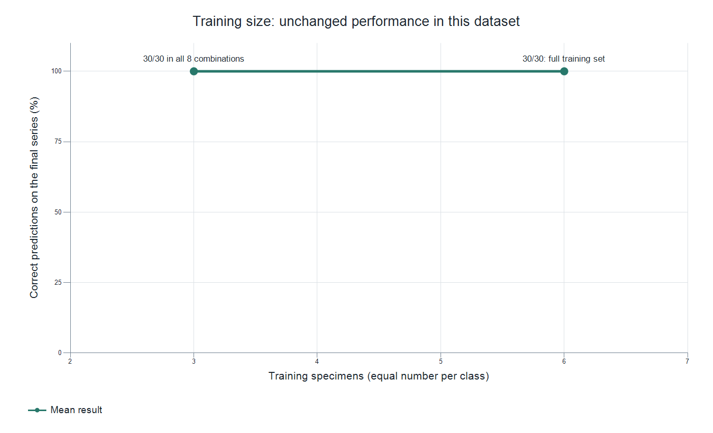

*The left point combines eight three-specimen configurations; all scored 30/30. The right point uses the full six-specimen training set. The line connects two tested sizes, not intermediate experiments. This is post-hoc analysis of an already examined test set, not independent validation. Two tested sizes do not establish a general learning curve.*

## 9. Reducing measurement time

Slow mode waits 30 seconds and averages 30 pulse pairs. Fast mode reduces the initial wait to 5 seconds and the number of pairs to six. Total recorded time fell from 44.6 to 7.6 seconds, approximately a 5.9× speedup, with the same model and feature definitions.

Less averaging can increase sensitivity to random fluctuations. I therefore evaluated fast mode in a separate recorded series, described below.

## 10. Final evaluation protocol

The model was fixed before the series and was not updated from its results. I tested 15 reported new specimens: five potatoes, five apples and five cucumbers, labeled FINAL01–FINAL15. Each received two placements in different positions, scored separately rather than combining their predictions.

All 30 saved measurements took 7600 ms from start to result. Each record includes six mean voltages, prediction, acquisition settings and the model file hash. The hash identifies the file contents and is identical across the series.

The protocol was mixed: some first placements withheld the actual class until after prediction, while repeats and cucumber trials were open-label. The unchanged firmware selected the class from electrical measurements. The whole series was not fully blind, and class order was grouped: potatoes, then apples, then cucumbers.

## 11. Results

| Actual specimen | Predicted potato | Predicted apple | Predicted cucumber | Specimens |
|---|---:|---:|---:|---:|
| Potato | 10 | 0 | 0 | 5 |
| Apple | 0 | 10 | 0 | 5 |
| Cucumber | 0 | 0 | 10 | 5 |

Accuracy here means correct predictions divided by placements. Rows show actual class and columns predicted class. All 30 placements were classified correctly; all 15 specimens were correct in both placements. No invalid measurements occurred in this series. Two placements from one specimen are dependent: there are 15 physical specimens, not 30 independent specimens or 180 independent examples from the pulse cycles.

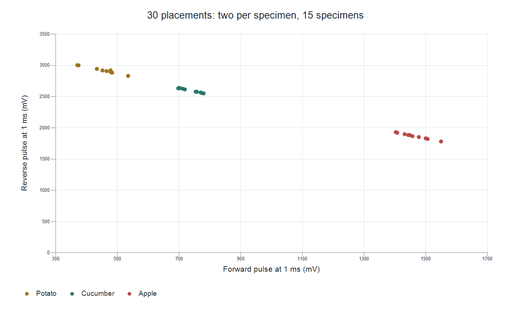

*Two of the six coordinates are shown: forward and reverse voltages at 1 ms. Each point is a placement. Separation applies to this dataset rather than universal class boundaries.*

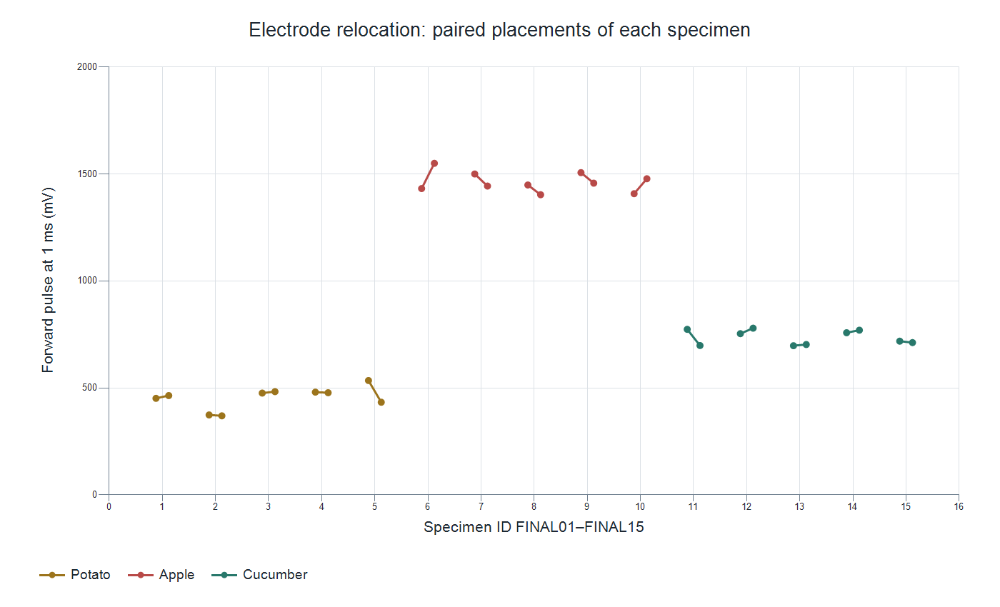

*The two points beside each specimen ID represent its first and second placements. Relative change is the absolute difference in F1 divided by the first-placement F1, multiplied by 100%. The largest change was 19.0%; the predicted class remained unchanged.*

## 12. Interpreting the result

The result comes from one assembly and one session, with 15 physical specimens and 30 freehand placements. The model uses six mean voltages that include tissue and contact effects. Final logs retain means rather than individual cycle readings.

For valid signals, the classifier selects one of three known classes. Purple indicates ADC counts near the range limits. Preliminary and final results are reported separately.

The repository includes firmware, model coefficients, source recordings and analysis scripts so the numerical results can be reproduced.

## 13. Operating the prototype

Briefly press and release BOOT for fast mode, or hold about two seconds and release for slow mode. Remove your hands and wait while the LED is blue. Red means apple, yellow potato, and green cucumber. Start a new measurement after inserting the electrodes into the next specimen.

## Conclusion

The single-electrode pilot showed overlapping readings and sensitivity to the measurement assembly. The two-electrode circuit provided six transient-voltage features for on-device classification. In the final recorded series, the prototype correctly recognized all 15 specimens: 30 correct predictions from 30 placements, at 7.6 seconds per result.
